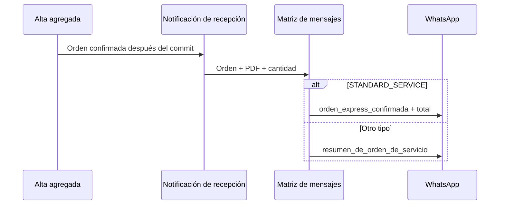

# Diseño

La matriz de mensajes conserva la responsabilidad de seleccionar el contrato de Meta. El servicio de notificación prepara el documento y la matriz elige la plantilla según `serviceType`, evitando que la generación del PDF conozca detalles del proveedor.

`montoComprometidoVigente` es la proyección persistida del acuerdo inicial aceptado para servicios directos y se usa como total comunicado. El valor se formatea en PEN con dos decimales antes de construir la plantilla.

